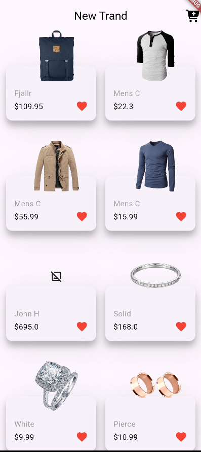
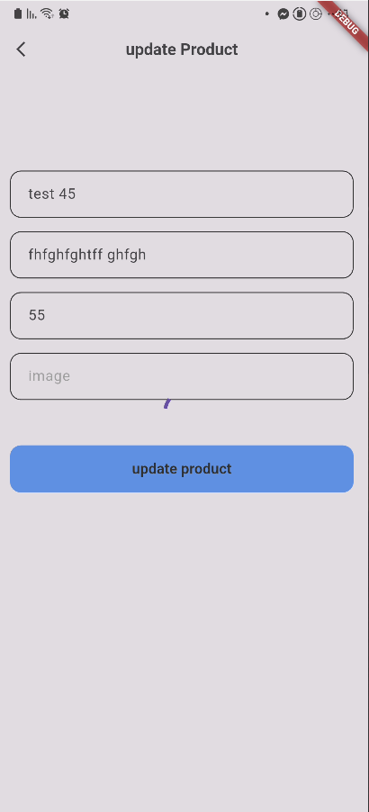

# Story App

A Flutter product catalog application built with the [Fake Store API](https://fakestoreapi.com/). It displays products in a responsive grid and provides reusable API, model, navigation, and UI components for working with products.

## Preview

| Home screen | Update product screen |
| --- | --- |
|  |  |

**Demo video:** [Watch the app demo](docs/media/app-demo.mp4)

> - `docs/media/home-screen.png`
> - `docs/media/update-product-screen.png`
> - `docs/media/app-demo.mp4`

## Features

- Fetches and displays all products from Fake Store API.
- Presents products in a two-column grid with a loading state and error state.
- Opens an update form for each product.
- Updates a product with a `PUT` request to its product-specific endpoint.
- Keeps the existing product value for any update field left empty.
- Provides services for adding products, loading all categories, and loading products in a category.
- Converts API JSON to typed product and rating models.
- Supports API prices returned as either numbers or numeric strings.
- Handles products that do not include rating data.
- Reuses custom buttons, text fields, app bars, snackbars, cards, and navigation helpers.

## Tech stack

- [Flutter](https://flutter.dev/) and Dart
- [`http`](https://pub.dev/packages/http) for REST requests
- [`font_awesome_flutter`](https://pub.dev/packages/font_awesome_flutter) for icons
- [`modal_progress_hud_nsn`](https://pub.dev/packages/modal_progress_hud_nsn) for the update loading overlay
- [Fake Store API](https://fakestoreapi.com/) as the demo backend

## API usage

| Purpose | HTTP method | Endpoint |
| --- | --- | --- |
| Load all products | `GET` | `/products` |
| Add a product | `POST` | `/products` |
| Update a product | `PUT` | `/products/{id}` |
| Load categories | `GET` | `/products/categories` |
| Load products by category | `GET` | `/products/category/{categoryName}` |

All endpoints use the base URL `https://fakestoreapi.com`.

> Fake Store API is a demo API. Write requests return a sample response and are not permanently saved on its server.

## Project structure

```text
lib/
├── core/
│   ├── helper/       # API client and snackbar helper
│   ├── models/       # ProductMode and RatingModel
│   ├── routes/       # Navigation helper
│   ├── services/     # Product and category API services
│   └── widgets/      # Reusable UI components
├── feature/
│   ├── home_page/    # Product grid and product card
│   └── update_product_page/ # Product update form
└── main.dart          # App entry point

test/
└── product_mode_test.dart # Product JSON parsing tests
```

## Getting started

### Prerequisites

- Flutter SDK compatible with Dart `^3.12.2`
- An emulator, simulator, browser, or physical device

### Installation

```bash
git clone <your-repository-url>
cd story_app
flutter pub get
flutter run
```

## Testing

Run the test suite with:

```bash
flutter test
```

The model tests cover numeric and string prices, optional ratings, and rating parsing.

## Main components

| Component | Responsibility |
| --- | --- |
| `Api` | Sends GET, POST, and PUT requests and decodes JSON responses. |
| `ProductMode` | Represents a product returned by the API. |
| `AllProductService` | Retrieves the product catalog. |
| `AddProduct` | Creates a product through the API. |
| `UpdateProductService` | Sends updates to a specific product ID. |
| `AllCategoriesService` | Retrieves category names. |
| `CategoriesServiec` | Retrieves products for one category. |
| `HomePage` | Displays the catalog and request states. |
| `UpdateProductPage` | Lets the user edit a selected product. |


